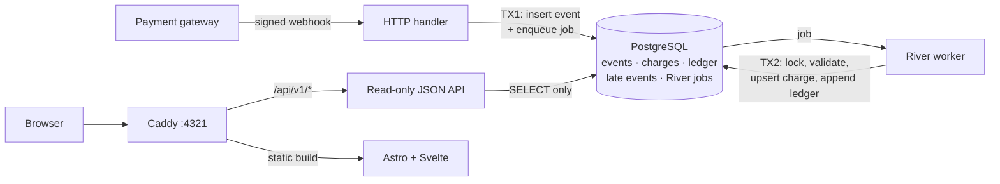
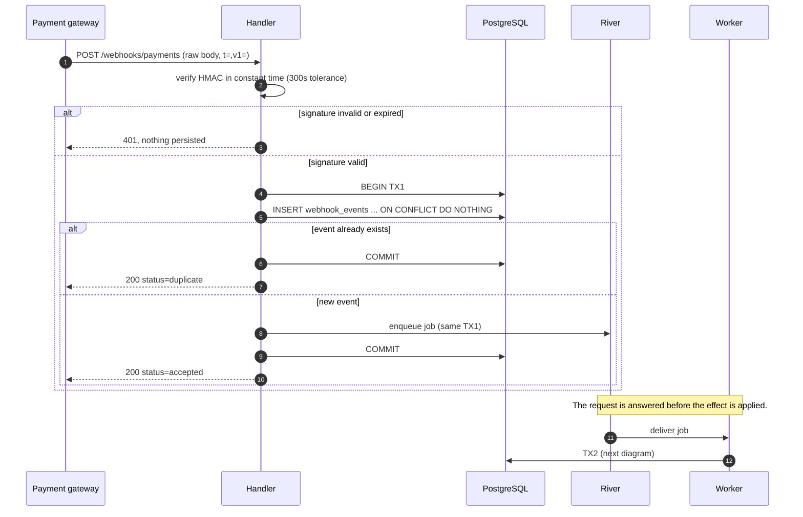
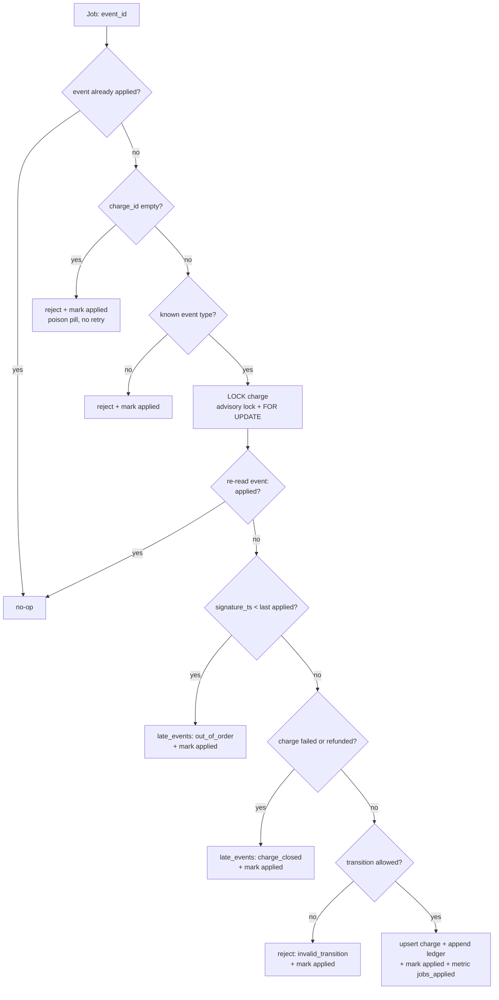
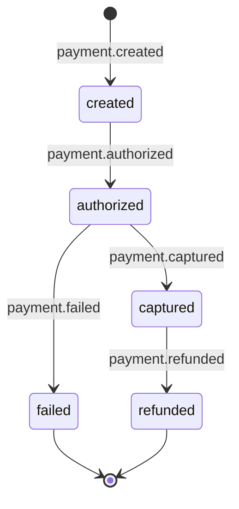
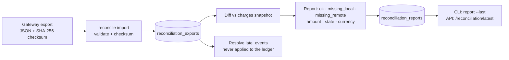

# webhook-guard — architecture and flows

`webhook-guard` ingests payment-gateway webhooks and applies them to a ledger **idempotently and
in order**. This document is the visual companion to the README: the same system from five angles.
The diagrams are Mermaid, so GitHub renders them directly.

> Reference implementation, not a production service: no auth, no multi-user, loopback by default.
> The point is to make the guards (and their failure modes) visible and testable.

## 1. System at a glance

The Go service and the River worker share one PostgreSQL database. The dashboard is a static Astro
build served by Caddy, which proxies `/api/*` to the read-only Go JSON API. The browser never talks
to Postgres and never sees the signing secret.

## 2. Ingest path: two transactions

The request path does the minimum: verify the signature, persist the event once and enqueue the
job — all in TX1. The HTTP response is sent **only after TX1 commits**. The effect is applied later
in TX2, so the gateway never waits on ledger work.

Why this split: a duplicate delivery produces **one** effect because uniqueness is enforced by the
database (`ON CONFLICT`), not by a check-then-insert race. And if TX1 fails, the service answers an
error so the gateway retries instead of dropping the event.

## 3. Worker decision flow (TX2)

Every rejection and every late event still **marks the event applied** and records a metric, so a
poison job is never retried forever.

Two details worth calling out:

- The event is **re-read after the lock**. A concurrent job may have applied it between the first
  read and the lock; the second check makes idempotency hold under concurrency.
- The ordering watermark uses `signature_timestamp` (second resolution). Two events signed in the
  same second apply in arrival order; a strictly older timestamp is a late event.

## 4. Charge state machine

The transition table is the single source of truth, shared by the guard and the worker. Anything
not listed is rejected and recorded, never applied "just in case".

`charges.amount_minor` keeps the charge's **original** amount: only `payment.created` sets it. Each
movement (for example a refund) is a new **append-only ledger entry**, never an overwrite.

## 5. Reconciliation

Reconciliation compares local state against the gateway export. It reports diffs as an artifact and
never rewrites ledger rows. It is also the consumer of the late-event queue: a late event is
resolved, never applied to the ledger.

## 6. Guarded vs naive

Two implementations of the same `guard.Guard` interface, chosen at build time (`!naive` vs
`naive`). The naive build exists only as a counterexample under load, never as production.

| Concern | Guarded (default) | Naive (comparison) |
| --- | --- | --- |
| Duplicate delivery | `ON CONFLICT`, one effect, `200 duplicate` | plain `INSERT`, unique violation, `500` |
| Per-charge ordering | advisory lock + `SELECT ... FOR UPDATE` | no lock, read without `FOR UPDATE` |
| State transitions | allowlist, invalid rejected | any transition applied |

A local reference run (500 logical events = 1000 requests, concurrency 20) makes the difference
visible: guarded answers 500 accepted / 500 duplicate / 0 5xx; naive answers 500 accepted / 0
duplicate / 500 5xx. The numbers are a local measurement, not a benchmark.

## 7. What the dashboard shows

A read-only window over the same database: event inbox, charges and their revision strip, the
append-only ledger, late events, metrics, reconciliation reports, and a guarded-vs-naive
comparison that can ingest a real loadgen run through a gated endpoint (`LOADGEN_INGEST`). The
frontend never holds `DATABASE_URL` or the signing secret; every number is traceable to a row.
